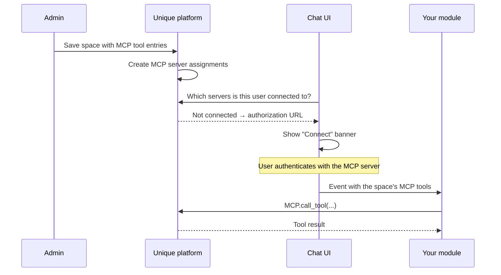

# Calling MCP Tools from a Custom Module

## 📌 Overview

[Using MCP Tools in Unique AI](mcp_unique_ai.md) covers enabling MCP tools on a standard Unique AI space, where the built-in agent decides when to call them. This guide covers the other case: a space driven by your **own external module**, where your code receives the space's MCP tools and calls them itself.

The division of labour matters, and it is the part most people get wrong. Your module does not discover MCP servers, and it does not handle OAuth. The space owns both. Your module only consumes the result.

See the full example here: [https://github.com/Unique-AG/ai/tree/main/tutorials/mcp/mcp_custom_module](https://github.com/Unique-AG/ai/tree/main/tutorials/mcp/mcp_custom_module)

**Prerequisites:**

- An MCP server already registered for your organization — see [MCP Fundamentals](mcp_fundamentals.md) and [MCP Connectors for Admins](https://unique-ch.atlassian.net/wiki/x/EoD4Yg)
- A space configured with an external module
- Python 3.12+

## 🏗️ How it fits together



## ⚙️ Module configuration

MCP tools are declared as entries on the module's `tools` array. Two fields are what the platform actually reads:

- `mcpTool: true` marks the entry as an MCP tool
- `mcpServerId` is the **id of the MCP server row**, not its display name

`name` is the tool's name as stored on that server. A name that matches no enabled tool is skipped, and that server never reaches the space.

```json
{
  "languageModel": "AZURE_GPT_4o_2024_1120",
  "tools": [
    {
      "name": "jira_search",
      "isEnabled": true,
      "configuration": {
        "mcpTool": true,
        "mcpServerId": "<atlassian-mcp-server-id>"
      }
    },
    {
      "name": "search_repositories",
      "isEnabled": true,
      "configuration": {
        "mcpTool": true,
        "mcpServerId": "<github-mcp-server-id>"
      }
    }
  ]
}
```

Add more tools from the same server as further entries carrying the same `mcpServerId`.

### Where the `tools` array may sit

The platform looks in exactly two places, and there is no recursive search:

| Stored shape | Lookup order |
|---|---|
| Flat (the usual case) | `tools`, then `space.tools` |
| Nested — the object has **both** a `space` and an `agent` key | `space.tools`, then `tools` |

Anywhere else — `mcp.tools`, `agent.tools`, or a `tools` array nested deeper — resolves to nothing. No server assignments are written on save, the chat never learns the space has MCP servers, and your module's events arrive with no servers on them. Prefer the flat shape unless you are deliberately writing the nested Unique AI configuration.

!!! warning "Do not use `ToolBuildConfig`"
    `ToolBuildConfig` has neither `mcpTool` nor `mcpServerId` and silently drops both. Build these entries from plain models and dump them with `model_dump(by_alias=True)` so the keys stay camelCase. The example ships a `configuration.py` that does exactly that.

## 🔌 Authentication is the platform's job

Saving the space turns the entries above into the space's MCP server assignments. From then on the chat asks each server whether the current user is authenticated and shows a **Connect** banner above the message box for any server that is not; **Reconnect** appears when a session expires mid-chat.

Your module renders none of this and cannot trigger it. On each message the platform sends the tools it resolved for the space. Each tool includes `isConnected`. That flag means the chat-service instance that built the event currently holds a live client for the tool. It is often `false` for a tool you can still call, so do not filter on it — doing so hides working tools. An empty list means nothing was resolved for the turn. Say so, and point at the banner, rather than failing a tool call.

One more condition applies to the banner specifically: a server surfaces only when at least one of its tools is enabled. A server whose tools are all disabled still gets its assignment row, but users are never prompted to connect it.

## 📨 What the event carries

On `unique.chat.external-module.chosen`, the tools the platform resolved arrive on `payload.mcpServers`. Your stored `languageModel` is available on `payload.configuration`. Do not treat `isConnected` as "the user finished the Connect banner" — see above.

!!! danger "Tool names differ between the configuration and the event"
    The configuration stores the bare name (`jira_search`). The event delivers the **namespaced** `<server>_<tool>` form (`atlassian_jira_search`), and that is the name `MCP.call_tool` expects. Calling with the bare name will not route.

## ▶️ Running the example

```bash
cd tutorials/mcp/mcp_custom_module
cp unique.env.example unique.env   # then fill it in
```

The same handler is reachable two ways:

| Entry point | Transport | Use when |
|---|---|---|
| `uv run python -m mcp_custom_module.app` | FastAPI webhook, built with `build_unique_custom_app` | Production. Needs a URL the platform can reach, so a tunnel such as ngrok while developing. |
| `uv run python -m mcp_custom_module.sse` | Event socket (SSE) | Development on a machine that cannot expose a port. The connection opens outbound, so no public URL and no tunnel. |

The SSE path additionally needs `UNIQUE_AUTH_COMPANY_ID` and `UNIQUE_AUTH_USER_ID` — the stream runs on behalf of those credentials — and at least one of `UNIQUE_CHAT_EVENT_FILTER_OPTIONS_ASSISTANT_IDS` or `UNIQUE_CHAT_EVENT_FILTER_OPTIONS_REFERENCES_IN_CODE`. The stream carries every `unique.chat.external-module.chosen` event the app can see, and with both filters unset every event is dropped.

!!! warning "The event socket is for development only"
    It has no delivery guarantee and no replay, and it closes after about ten minutes. The example reconnects, but events that arrive while it is down are lost.

## 💬 Using it

Send any message in the space and the module replies with its configured model and the tools on the event. To call a tool, send its name and arguments as JSON:

```json
{ "name": "atlassian_jira_search", "arguments": { "jql": "project = UN" } }
```

## 🔗 Additional Resources

- [MCP Tools Across Sub-Agents](mcp_subagents.md) - Surfacing the login prompts for a sub-agent's MCP servers on the orchestrator space
- [Using MCP Tools in Unique AI](mcp_unique_ai.md) - Enabling MCP tools on a standard space
- [MCP Fundamentals](mcp_fundamentals.md) - Understanding the basics of building MCP servers
- [Production MCP Server Template](mcp_server_template.md) - Production-ready server template
- [MCP Connectors for Admins](https://unique-ch.atlassian.net/wiki/x/EoD4Yg) - How to enable MCP connectors for your organization
