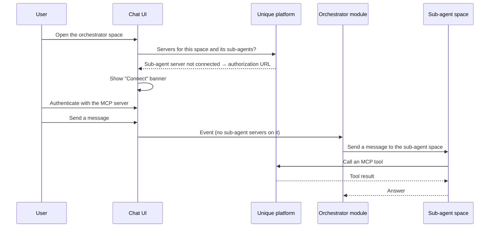

# MCP Tools Across Sub-Agents

## 📌 Overview

[Calling MCP Tools from a Custom Module](mcp_custom_module.md) covers one space with its own MCP servers. This guide covers the next shape: an **orchestrator** space that delegates to **sub-agent** spaces, where each sub-agent carries its own MCP servers and each of those servers needs the user to authenticate.

The question this answers is where the login prompt comes from. A user opens the orchestrator. The servers belong to the sub-agents, which the user may never open directly. The prompt still has to appear up front, before the orchestrator delegates anything.

It does — but only when the spaces are linked. The chat asks for the servers of the space on screen **and** of its linked sub-agents. A sub-agent you merely call by assistant id from your own code is invisible to that lookup, and its servers are never offered for connection.

**Prerequisites:**

- An MCP server already registered for your organization — see [MCP Fundamentals](mcp_fundamentals.md) and [MCP Connectors for Admins](https://unique-ch.atlassian.net/wiki/x/EoD4Yg)
- Familiarity with the tool-entry configuration from [Calling MCP Tools from a Custom Module](mcp_custom_module.md)

!!! note "Read from the platform sources, October 2026"
    Which spaces the Connect banner asks about, and what each module event carries, was read from the chat service. It has not been re-checked on a live tenant.

## 🏗️ How it fits together



The banner and the delegation are two separate paths. The chat resolves the sub-agents to decide what to prompt for; your orchestrator resolves them again, itself, to decide what to call.

## ⚙️ Configuring a sub-agent

A sub-agent is an ordinary space with two additions: it is marked as a sub-agent, and it owns its MCP tool entries.

The tool entries are exactly the ones from [the custom module guide](mcp_custom_module.md) — `mcpTool: true` plus the `mcpServerId` of the server row — and they live on **this** space's module configuration, not the orchestrator's:

```json
{
  "languageModel": "AZURE_GPT_4o_2024_1120",
  "tools": [
    {
      "name": "jira_search",
      "isEnabled": true,
      "configuration": {
        "mcpTool": true,
        "mcpServerId": "<atlassian-mcp-server-id>"
      }
    }
  ]
}
```

Create it with `isSubAgent=True`, passing that JSON as the module's configuration:

```python
research = unique_sdk.Space.create_space(
    user_id=user_id,
    company_id=company_id,
    name="Research sub-agent",
    fallbackModule="MySubAgent",
    modules=[
        {
            "name": "MySubAgent",
            "weight": 10000,
            "configuration": module_configuration,  # the JSON above
        }
    ],
    isSubAgent=True,
)
```

A second sub-agent with a different server is the same space again, with its own `mcpServerId` in its own tool entries. Keep each sub-agent's servers on that sub-agent.

!!! note "`subAgentSettings` is not part of this"
    `subAgentSettings` names and labels the space when it is offered as a sub-agent. It has no bearing on MCP: no server assignment reads it, and no login prompt depends on it.

## 🔗 Linking the orchestrator

The orchestrator lists the sub-agents it delegates to. That list is the whole link:

```python
orchestrator = unique_sdk.Space.create_space(
    user_id=user_id,
    company_id=company_id,
    name="Research orchestrator",
    fallbackModule="MyOrchestrator",
    modules=[{"name": "MyOrchestrator", "weight": 10000}],
    subAgentIds=[research["id"]],
)
```

`subAgentIds` is the **full** list on update, not an addition — send every sub-agent that should remain linked.

The orchestrator does not need the MCP servers assigned to itself, and should not duplicate the sub-agents' tool entries. If the orchestrator calls servers of its own, those are configured on the orchestrator exactly as in the single-space guide, and are prompted for alongside the sub-agents'.

## 🔌 What the user sees on first open

Opening the orchestrator resolves its linked sub-agents, collects every MCP server assigned to any of them, and checks the current user's credential for each. Servers without a valid credential produce an authorization URL and the **Connect** banner; a credential that expires mid-chat produces **Reconnect**.

Credentials are stored per user and per server, so a single login covers every space that uses that server. Two sub-agents sharing one server yield one prompt, not two. When the orchestrator later delegates, the sub-agent's turn runs against the credential the user created on the orchestrator page.

### When the banner does not appear

Each of these silently removes a server from the prompt, which is the failure mode worth knowing:

| Condition | Effect |
|---|---|
| The sub-agent is not in the orchestrator's `subAgentIds` | Its servers are never looked up |
| The space is not marked `isSubAgent` | It cannot be linked at all; linking rejects it |
| The user lacks Use access to the sub-agent | That sub-agent is dropped, and its servers with it |
| No tool is enabled on the server for that sub-agent | The assignment exists, but nothing is offered to connect |
| A tool name matches nothing the server advertises | The entry is skipped, and with it the assignment |
| The server is space-restricted | It must allow-list the **sub-agent**, not the orchestrator |

Only **direct** sub-agents are resolved. A sub-agent's own sub-agents are not — and in fact cannot exist, since a sub-agent may not itself be a parent. Keep the hierarchy one level deep.

## 📨 What each module receives

The two sides of the run see different things, and this is the part that surprises people:

| | Sees sub-agent MCP servers | Sees sub-agents as tools |
|---|---|---|
| Orchestrator event | No | Only for built-in agent spaces |
| Sub-agent event | Yes — its own, on `payload.mcpServers` | — |

A sub-agent's MCP tools arrive on the **sub-agent's** event, when that space runs. The orchestrator's event carries only the orchestrator's own servers. There is no payload field that hands a parent its children's tools.

Spaces driven by one of the platform's built-in agents (Unique AI, Conduct) get `SubAgentTool` entries injected into their configuration, so those agents can delegate on their own. A custom module gets no such entry and must call the sub-agent space itself, by assistant id.

`max_wait` defaults to 60 seconds. A sub-agent that calls MCP tools often needs longer, so pass it. 180 below is an illustration, not a tuned limit:

```python
from unique_sdk.utils.chat_in_space import send_message_and_wait_for_completion

answer = await send_message_and_wait_for_completion(
    user_id=event.user_id,
    company_id=event.company_id,
    assistant_id=sub_agent_assistant_id,
    text="Summarise the open issues for project UN",
    max_wait=180,
    correlation={
        "parentMessageId": event.payload.assistant_message.id,
        "parentChatId": event.payload.chat_id,
        "parentAssistantId": event.payload.assistant_id,
    },
)
```

`correlation` ties the sub-agent's chat back to the message that triggered it, so the delegation stays traceable.

From there the sub-agent's own module runs as in the single-space guide: it reads `event.payload.mcp_servers` and calls tools by their namespaced `<server>_<tool>` names. As on that page, `isConnected` is not a login check and is not a reason to drop a tool. [`tutorials/mcp/mcp_custom_module`](https://github.com/Unique-AG/ai/tree/main/tutorials/mcp/mcp_custom_module) is a runnable module that does exactly that, and works unchanged as a sub-agent.

## 🧭 Putting it together

1. Configure each sub-agent with its own MCP tool entries, and mark it `isSubAgent`.
2. Link them from the orchestrator with `subAgentIds`.
3. Grant the chatting user Use access to the orchestrator **and** to every sub-agent.
4. Open the orchestrator and connect the servers the banner offers.
5. Have the orchestrator call each sub-agent by assistant id; the sub-agent calls its own MCP tools.

## 🔗 Additional Resources

- [Calling MCP Tools from a Custom Module](mcp_custom_module.md) - The single-space case, with a runnable module
- [Using MCP Tools in Unique AI](mcp_unique_ai.md) - Enabling MCP tools on a standard space
- [MCP Fundamentals](mcp_fundamentals.md) - Understanding the basics of building MCP servers
- [MCP Connectors for Admins](https://unique-ch.atlassian.net/wiki/x/EoD4Yg) - How to enable MCP connectors for your organization
